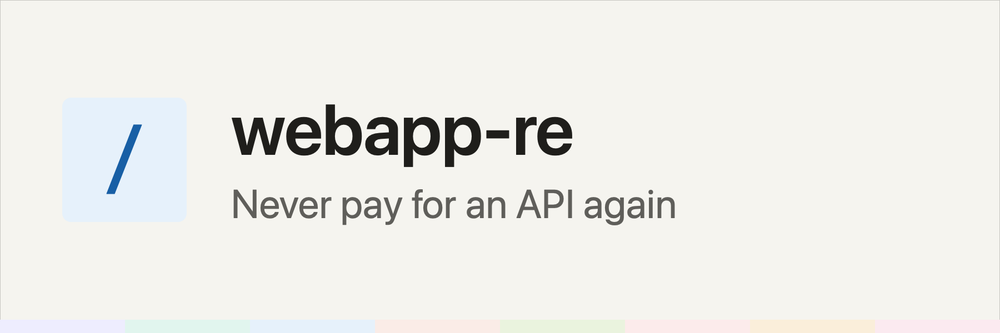

<picture>
   <source media="(prefers-color-scheme: dark)" srcset="img/banner-dark.png">
   
</picture>

# webapp-re

A Claude Code plugin that finds the private HTTP API behind a web app you're signed into, and
turns what it finds into a small automation program plus a `/<site>:` plugin of its own.

It uses the session from your own signed-in browser rather than a password. Requests are spaced
out, and a call that would change data on the site waits for your approval.

## What it needs

- Claude Code, with plugin support (tested on 2.1.296)
- [uv](https://docs.astral.sh/uv/). Every script is a uv inline script, so uv fetches Python 3.11
  or newer and the one dependency (`websockets`, for the CDP capture) on its own
- A Chromium browser, driven either through the Claude in Chrome extension or over CDP on a
  separate profile you sign into by hand

## Installing it

```bash
claude plugin marketplace add stafawashere/webapp-re
claude plugin install webapp-re@webapp-re
```

Inside a session the same thing is `/plugin marketplace add stafawashere/webapp-re`, then
`/plugin install webapp-re@webapp-re`. Start a new session afterwards and `/webapp-re:` lists
every stage.

## Using it

Each stage is its own skill and reads what the stage before it wrote from a fixed path, so you
never pass files between them.

```
/webapp-re:reverse <site> <goal>             find and verify the request behind one goal
/webapp-re:scope <site or url>               walk the site read-only and list what it can do
/webapp-re:plan <site>                       design the commands, schemas and build order
/webapp-re:engineer <site> [commands...]     build the program and the /<site>: plugin
/webapp-re:optimize <site> [names...] [--auto]
                                             audit, then apply the findings you accept
/webapp-re:optimize <site> --apply [run-id]  apply the findings of an earlier audit
/webapp-re:integrate-menu <site>             give /<site>:menu a self-syncing menu
/webapp-re:webapp-re help                    list the commands and each site's progress
```

`reverse` is the method the other stages lean on. You give it a site and a goal phrased as
something you'd do, like `app.example.com: list the items on my saved list`, and it captures the
traffic, narrows it to the one call that does the job, replays it, and writes the result into the
site's knowledge base. `scope` runs the same method across the whole site, read-only, and
`plan` turns its inventory into commands without sending any requests. Once a plan exists,
`engineer` builds the program and the site plugin and checks every command against the live
site. `optimize` audits a built site's plugin and program, and changes nothing until you've accepted
its findings.

`/webapp-re <stage> ...` works too. It goes through the `webapp-re` skill, which hands off to the
stage you name.

## What you end up with

For `app.example.com`, a full run leaves this under `$WEBAPP_RE_HOME/example/`:

```
site.json            slug, origins and the browser in use
scope/               scope.md and scope.json, the inventory of the app
plan/                plan.md and plan.json, the commands and their build order
knowledge/           one file per verified endpoint, plus patterns, sessions and a changelog
openapi/             example.openapi.yaml, rendered from the verified endpoints
program/             the automation library and CLI, a uv project
plugin/              the /example: plugin that calls program/
```

After that, `/example:help` lists the site's commands and `/example:example <command>` runs one
through the program. The knowledge base is plain Markdown, and `reverse` reads it first, so a goal
whose endpoint was verified and replayed in the last 30 days skips the capture and goes straight
to reproducing the call.

## Pacing and your account

The generated program keeps one request in flight, waits at least 3 seconds between requests to
the same origin with some jitter, and retries only transport errors. A 429, a challenge page or a
checkpoint stops the whole client rather than the one call. Cookies come from a `.env` file you
fill from your own browser, kept at mode 600 and redacted in every log. A password login is never
automated unless you ask for it, and the password is never stored. The reasoning and the defaults
are in [plugin/references/pacing-and-safety.md](plugin/references/pacing-and-safety.md).

Use it on accounts you own, and read the site's terms first, because some sites don't allow
automated access to their private API even from your own session.

## Where your sites go

Every site gets one workspace under `$WEBAPP_RE_HOME/<slug>/`. `WEBAPP_RE_HOME` defaults to
`~/dev/webapp-re/apps`, and you can point it anywhere. The slug is the registrable domain without
its public suffix, so `app.example.com` and `www.example.com` both become `example`. The full tree is in
[plugin/references/site-layout.md](plugin/references/site-layout.md).

Each workspace is its own git repository (`kb.py init` runs `git init`). The generated plugin, the
captures in `var/` and the cookie file `.env` are gitignored in the workspace, because they're
tied to your account. Nothing is committed or pushed for you. The site plugins are listed in a
local marketplace named `webapp-re-local`, written to `.claude-plugin/marketplace.json` in the
parent of `WEBAPP_RE_HOME` (or `$WEBAPP_RE_MARKETPLACE`), and `kb.py init` adds each new site
to it.

## How it's laid out

`plugin/` is the plugin itself. `skills/` holds the router, one skill per stage, and two vendored
skills, `js-reverse` and `web-api-reverse-engineering`, both MIT and listed with their source
commits in [docs/third-party-skills.md](docs/third-party-skills.md). `scripts/` has `kb.py` (the
per-site knowledge base), `site_plugin.py` (the site plugin generator), `cdp_capture.py`,
`shape.py`, the scope and plan checkers and `optimize_run.py`. `references/` has the method and
format docs the skills load, and `menu/` the site menu builder.

[docs/architecture.md](docs/architecture.md) walks through the stages and the data flow between
them.

## Running the tests

From the repository root:

```bash
uv run --script tests/test_build_menu.py
```

That runs 22 tests for the menu builder. [tests/README.md](tests/README.md) has the checker
fixtures, the output each one should give, and the commands to run them. CI runs the same tests
and checkers on every push.

## License

MIT, see [LICENSE](LICENSE). The two vendored skills keep their own MIT licenses in their folders.
